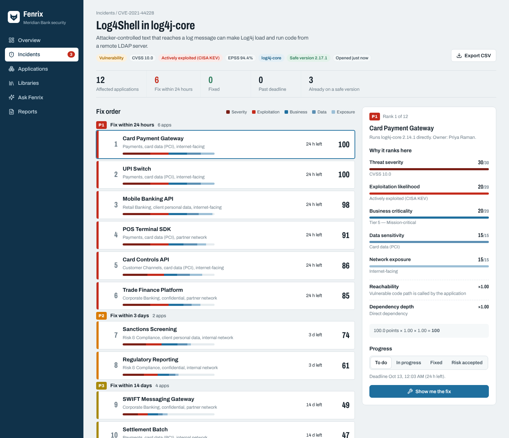
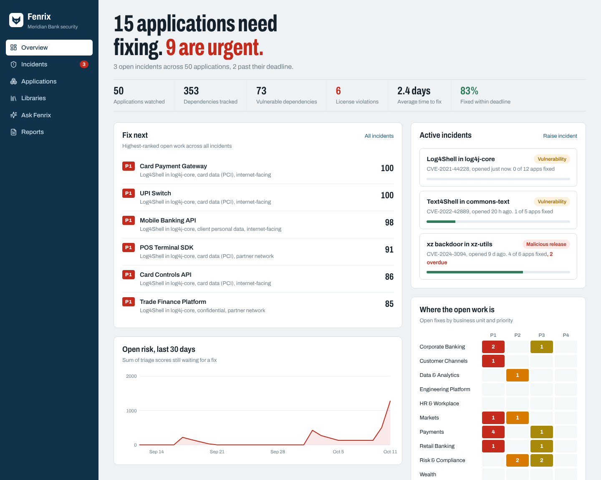
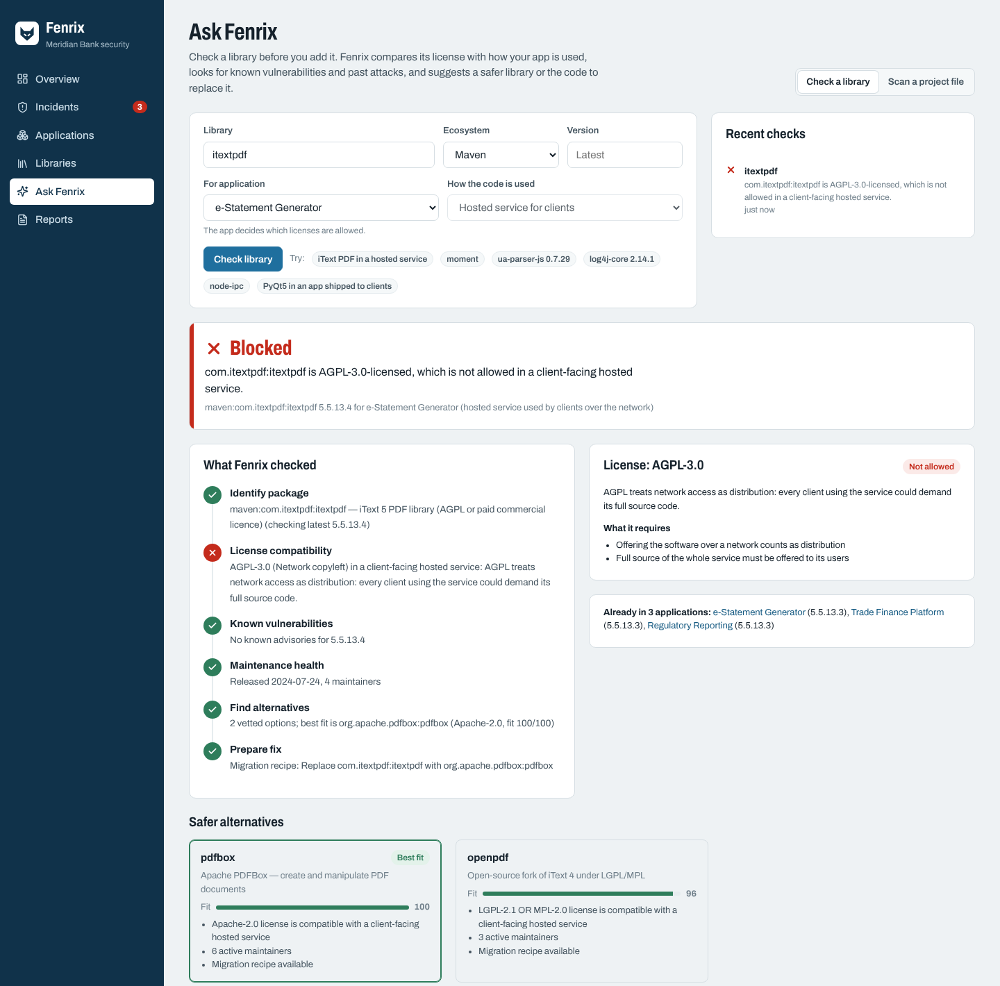
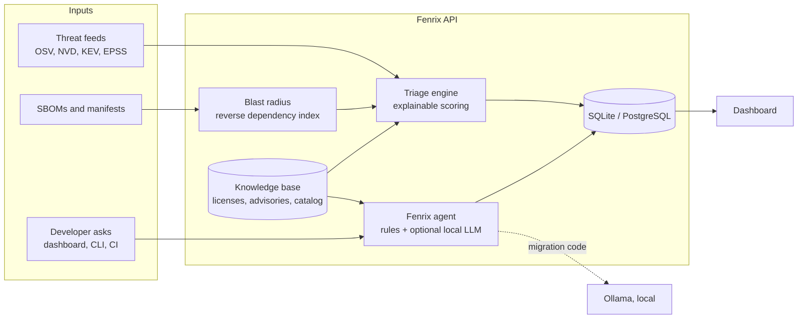

# Fenrix

**When an open-source library is compromised, Fenrix tells your security team which application to fix first.**

A large company runs hundreds of applications. When a threat-intel feed says *"log4j-core is being exploited"* or *"this npm package was hijacked"*, the security team gets a list of affected apps, but not an order. Patching the internal to-do app before the card payment gateway is how client data leaks. Fenrix finds every affected application, ranks them by what is actually at stake, explains every rank, and stops risky libraries before developers add them in the first place.



## What it does

| | |
|---|---|
| **Blast radius** | Reverse-indexes every dependency (direct and transitive) across the portfolio, so "who uses library X at an affected version?" takes milliseconds. |
| **Fix-first triage** | Scores each affected app on threat severity, exploitation likelihood (CISA KEV, EPSS), business criticality, data sensitivity, network exposure and code reachability. Assigns P1 to P4 with SLA deadlines. |
| **Explainable scores** | Every rank shows its arithmetic, so an engineer, auditor or interviewer can recompute it by hand. |
| **Fenrix agent** | "Can I use this library here?" Checks license compatibility against how the app is shipped, known vulnerabilities, past supply-chain attacks and maintenance health. Suggests vetted alternatives with migration code, or says honestly when nothing fits and proposes in-house code instead. |
| **Shift-left gate** | The same agent runs as a CLI and in CI, so a pull request that adds an AGPL library to a client-facing service, or a known malicious release, fails before it merges. |

## A two-minute demo

1. Run Fenrix (below) and sign in with **Use demo account**.
2. The overview answers the question first: how many applications need fixing, and how many are urgent.
3. Click **Simulate Log4Shell** in the sidebar. Fenrix checks all 50 applications, finds 12 on a vulnerable version and 3 already safe, and ranks them. The card payment gateway and UPI switch (card data, internet-facing, vulnerable code reachable) score 100. The audit-trail service (internal, code not reachable, transitive) scores 37.
4. Click any application to see *why* it ranks there, then **Show me the fix**.
5. Open **Ask Fenrix** and try **iText PDF in a hosted service**: blocked because AGPL treats network use as distribution, with Apache PDFBox suggested and before/after code. Try **node-ipc**: no trustworthy alternative exists, so Fenrix proposes a small in-house replacement instead of a risky substitute.

| Overview | Ask Fenrix |
|---|---|
|  |  |

## How the ranking works

```
score = (severity + exploitability + business + data + exposure) × reachability × depth
```

| Factor | Max points | Source |
|---|---|---|
| Threat severity | 30 | CVSS base score / 10. Malicious or sabotaged releases count as 10. |
| Exploitation likelihood | 20 | 20 if on the CISA KEV list or malicious; otherwise EPSS probability × 20. |
| Business criticality | 20 | Application tier 1 to 5. |
| Data sensitivity | 15 | Card data 1.0, client PII 0.85, confidential 0.6, internal 0.3, public 0.1. |
| Network exposure | 15 | Internet 1.0, partner network 0.65, internal 0.3. |

| Multiplier | Values |
|---|---|
| Reachability | Vulnerable code called: ×1.0. Unknown: ×0.85. Not reachable: ×0.55. Ignored for malicious packages, whose payload runs on install. |
| Dependency depth | Direct ×1.0, transitive ×0.9. |

| Priority | Score | Deadline |
|---|---|---|
| P1 | 75 or more | 24 hours |
| P2 | 55 to 74 | 3 days |
| P3 | 35 to 54 | 14 days |
| P4 | below 35 | 30 days |

The weights are deliberately simple and live in one file ([`engines/triage.py`](backend/fenrix/engines/triage.py)), so a security team can tune them.

## The Fenrix agent: no API fees, no limits

The agent's **decisions** are made by deterministic code, not an LLM. License compatibility, vulnerability and malicious-release checks, and maintenance signals are rules over real data, so verdicts are reproducible, never hallucinated, and work offline.

```
identify package → license vs. usage → advisories & malicious versions → supply-chain history
→ maintenance health → decide (approve / conditions / block) → alternatives → fix
```

- **License policy** distinguishes how code is used: shipped to clients, hosted for clients, or internal only. GPL is fine in an internal tool and a violation in a mobile app; AGPL is a violation in any client-facing service. Licenses are version-aware (ua-parser-js became AGPL only in 2.0).
- **Alternatives** come from a curated catalog of real packages, ranked by license fit, maintainers, release recency and past compromises.
- **Fixes** are an upgrade snippet when a safe version exists, a reviewed migration recipe (moment → date-fns, iText → PDFBox, request → axios, PyQt5 → PySide6 and more), or, when no recipe exists, code drafted by a **local** LLM through [Ollama](https://ollama.com). Nothing is sent to a hosted API, so client code stays on the machine. Without Ollama, Fenrix falls back to recipes and guidance.

## CLI and CI gate

```bash
pip install ./backend

fenrix check itextpdf --ecosystem maven --usage saas
fenrix scan examples/pom.xml --usage saas      # exits 1 if anything is blocked
```

```
  BLOCK      org.apache.logging.log4j:log4j-core@2.14.1 — has serious known vulnerabilities.
             fix: Upgrade org.apache.logging.log4j:log4j-core to 2.17.1
  BLOCK      com.itextpdf:itextpdf@5.5.13.3 — AGPL-3.0-licensed, not allowed in a client-facing hosted service.
             fix: Replace com.itextpdf:itextpdf with org.apache.pdfbox:pdfbox
```

Reads `package.json`, `package-lock.json`, `requirements.txt`, `pyproject.toml`, `pom.xml` (including `${property}` versions), `go.mod`, CycloneDX and SPDX. To gate pull requests in another repository, copy [`docs/fenrix-gate.yml`](docs/fenrix-gate.yml). This repository's own CI runs Fenrix against its dashboard dependencies.

## Run it

**Docker** (one container serves the API and the dashboard):

```bash
docker compose up --build            # http://localhost:8000
docker compose --profile llm up      # also start a local LLM
```

**Local development:**

```bash
# API (Python 3.11+)
cd backend
pip install -r requirements.txt
uvicorn fenrix.main:app --reload            # http://localhost:8000/docs

# Dashboard (Node 22) in another terminal
cd frontend
npm install
NEXT_PUBLIC_API_URL=http://localhost:8000 npm run dev    # http://localhost:3000
```

Demo login: `analyst@fenrix.dev` / `fenrix-demo` (change with `FENRIX_DEMO_PASSWORD`). All settings are in [`.env.example`](.env.example).

## Architecture



```
backend/fenrix/
  engines/     triage.py, agent.py, versions.py, parsers.py, feeds.py, llm.py
  knowledge/   licenses.py, advisories.py, catalog.py, migrations.py
  api.py  services.py  models.py  seed.py  cli.py
frontend/app/  overview, incidents, incident, applications, libraries, agent, reports
```

**Stack:** FastAPI, SQLAlchemy 2, Pydantic, PyJWT · Next.js 15 (static export), React 19, TypeScript, hand-built SVG charts · pytest, ruff, GitHub Actions.

## About the data

- The 50 applications belong to **Meridian Bank, a fictional company**, and are generated deterministically so every demo shows the same numbers.
- Advisories are **real** (Log4Shell, Spring4Shell, Text4Shell, the xz backdoor, the ua-parser-js and event-stream hijacks, node-ipc and colors sabotage). CVSS values are NVD base scores; EPSS values are approximate snapshots. Malicious-package events without a CVE use internal `FNX-` IDs rather than invented CVE numbers.
- Library versions and release dates are an offline snapshot. Set `FENRIX_LIVE_FEEDS=true` to query OSV and the npm and PyPI registries live.

## Roadmap

- Reachability from real call-graph analysis instead of seeded values
- Scheduled OSV and KEV polling that opens incidents automatically
- Ticket creation in Jira or ServiceNow for each ranked fix
- SSO and per-team views

## Credits

Built by **Sukumar Manivel**.
